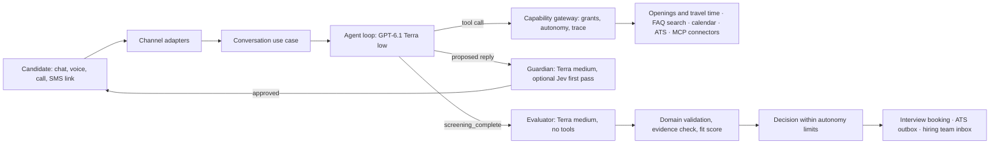

# Orbio · Conversational candidate screening

A screening platform for frontline hiring. One agent interviews candidates by chat,
voice or phone; an isolated evaluator turns the conversation into structured data
with evidence; the hiring team works from a console with an inbox, profiles, an
agenda and analytics. A forward deployed engineer (FDE) configures each client and
its job offers, mostly in natural language, without changing the product code.

The case study client is **Grupo Sazón**: 45 restaurants in Spain and Mexico,
around 1,000 delivery-driver applications a week and 13 recruiters who screen by
phone today. A second sample client, **Logística** (warehouse staff), runs on the
same core with its own configuration, to show that the second client is
configuration, not a fork.

| Deliverable | Where |
|---|---|
| Process design (phase 1, two pages) | [docs/process-design.md](docs/process-design.md) · [PDF](output/pdf/process-design-grupo-sazon.pdf) |
| Example conversations and structured output | [docs/example-conversations.md](docs/example-conversations.md) |
| Demo video (about 8 minutes) | Shared together with this repository |
| Installation, architecture, decisions and improvements | This README |

The detailed documentation under `docs/` is written in Spanish; this README, the
process design and the example conversations are in English.

## What it does

**Candidate.** Opens the offer link, accepts the privacy notice and talks to Sofía,
who says she is an AI assistant and asks one thing at a time, in Spanish or English.
The candidate can switch to voice in the browser (**Talk here**), ask for a phone
call (**Call me**) or receive an SMS with a personal link to pick the conversation
up later. History, collected data and the next step are shared across channels.
The candidate can book, move or cancel the interview from the same conversation.

**Hiring team.** An inbox for hand-offs (take over a live conversation, reply, hand
it back to the AI), each candidate's profile with the evaluation, the fit score and
the quote behind every data point, the full transcript, the interview agenda,
follow-ups and analytics: completion rate, drop-off stage, median and p90 duration.

**FDE.** Company identity and policies, job offers, a library of shared documents,
connectors and tools, autonomy, the exact prompt preview, the diff against the
published version, simulation with synthetic personas, evaluations, publication
with approvals, a pilot percentage, rollback, technical traces and a link to the
same session in Langfuse.

## Quick start

### 1. Requirements

**Docker with Compose**, **Python 3.12**, **uv 0.11**, **Node 24** and
**pnpm 12.10.1**. Run the commands from the repository root with Docker running and
ports `5173`, `5174`, `8000`, `8100`, `5432` and `6379` free.

```sh
docker info
docker compose version
uv sync --frozen
pnpm install --frozen-lockfile
```

### 2. Configuration

In a fresh copy:

```sh
cp .env.example .env
node tools/harden-local-env.mjs
```

The second command generates the local Django and ingestion keys and restricts
`.env`. Open `.env` and set `SEED_PASSWORD`: it is the password of the seeded users.
Do not share `.env`.

| Mode | `.env` | Use |
|---|---|---|
| No external keys | `LLM_MODE=fake` | Explore every screen, application, evaluation and flow with deterministic responses and no model cost |
| Real model | `LLM_MODE=openai` and `OPENAI_API_KEY_FILE=/absolute/path/to/key-file` | OpenAI `gpt-6.1-terra`: conversation at `low` reasoning, every other role at `medium`. Usage is charged to that account |

The key file contains only the key, with permissions `0600`; it is mounted only in
the API and the worker. AWS, Twilio and ElevenLabs are not needed to run the
consoles and the chat. Keep `PUBLISH_REQUIRES_EVALS=true`: the seed creates the
initial version, and publishing any later change requires its evaluations.

### 3. Start and seed

```sh
make up
make seed
curl --fail http://localhost:8000/api/v1/health
```

`make up` builds the containers, applies migrations and waits for them; health must
answer `{"status":"ok","db":"ok","redis":"ok"}`. `make seed` loads users, both
clients, published profiles, 45 locations with openings and calendars, and nine
synthetic applications. It calls no model and sends no messages. Its output contains
personal links: keep them local.

| Access | Address | User |
|---|---|---|
| FDE console | [localhost:5173](http://localhost:5173) | `fde@orbio.local` |
| Hiring team console | [localhost:5173](http://localhost:5173) | `reclutadora@orbio.local` |
| Second FDE (approvals) | [localhost:5173](http://localhost:5173) | `fde2@orbio.local` |
| New application | [Apply to the offer](http://localhost:5174/apply/grupo_sazon/repartidores) | No account |
| API | [Interactive docs](http://localhost:8000/api/v1/docs) | Depends on the operation |

All users share `SEED_PASSWORD`. Choose **Grupo Sazón** after signing in. The
consoles are in Spanish; the candidate chat follows the candidate's language.

The seed reproduces the scenario in [`seeds/tenants/grupo_sazon`](seeds/tenants/grupo_sazon/):
the offer **Repartidor/a · España y México**, eleven screening fields, 45 locations
and nine applications covering every outcome: two qualified with an interview (one
in English, in Mexico City), a rejection proposal for a missing licence that waits
for a person, two talent-pool proposals, a hand-off the team can take over, an
abandonment with its stage, a conversation in progress and one not started. Dates
are computed from the moment of seeding. Run it on a new database; it does not
replace existing profiles or drafts.

To enable semantic search over the seeded FAQ (49 Spanish and 15 English entries),
use `LLM_MODE=openai` and, in the FDE console, **Biblioteca → Consultar el índice de
una versión publicada → Indexar fuentes de búsqueda**. Indexing creates embeddings
and has a small cost.

### 4. Walk through it

1. **Hiring team:** in **Bandeja**, take over Carmen's conversation and reply. Open
   a profile and its evaluation; check Lucía's and Emily's interviews in **Agenda**
   (tick **Incluir pasadas** if they are already in the past).
2. **Candidate:** open the application link and apply. With `LLM_MODE=openai` the
   conversation is open-ended; `fake` does not interpret free answers.
3. **FDE:** edit the identity in **Empresa** and the role in **Ofertas**, the shared
   documents in **Biblioteca**; check the preview, the diff and the evaluations
   before publishing.

**Talk here**, **Call me** and SMS need provider configuration and consent
([voice](docs/voz.md), [channels](docs/twilio.md)); the seed leaves them off. In
this installation they serve test applications, which every locally created
application is, and calls go to Spanish mobiles.

The installation ships local connectors for openings, travel times, the interview
calendar and the ATS, plus a sample certificate registry behind MCP. They implement
the same ports a real integration would, but their data is seeded: openings and
travel times are not real availability or traffic, and the registry knows two sample
certificates. Interview reminders are posted in the web conversation only.

```sh
make down   # data stays in the Postgres volume; do not seed again to continue
make up
```

## How it works



**One agent with tools, not a chain of deterministic steps.** The conversation
agent follows the offer's brief and decides what to ask next. It uses tools to look
for openings near the candidate on their shift, search the client's documents (RAG
is just another tool), verify a credential, book or move the interview, or hand off
to a person. Every tool call goes through the
[`CapabilityGateway`](src/screening/application/capability_gateway.py), which
checks the role's grants, the offer's autonomy and the booking policy, and records
the call. The model is trusted with judgment, not with permissions.

**Every text reply is reviewed before it is sent.** The guardian checks for
sensitive questions, unsupported promises, privacy leaks, false claims of completed
actions and prompt injection; it can ask for up to two rewrites before handing the
conversation to a person. In front of it can sit **Jev**, a small decision model
(measured p50 0.44 s) that escalates doubtful replies to the Terra guardian.
Jev is optional (`JEV_MODE`, off by default). A few platform
notices (interview reminders and changes, automatic hand-offs, the answer to a
call request) are fixed templates filled with exact data, not model text.

**Where candidate data goes.** Conversations, results and traces stay in the
platform's Postgres. Conversation content is sent only to the configured model
provider (OpenAI, called with `store=False`) and, when enabled, to the voice and
messaging providers. The optional Langfuse export carries model, tokens, cost and
duration under a pseudonymous session key: no prompts, replies, names, phones or
outcomes. Jev receives content only in `synthetic` mode for synthetic applications,
or with `JEV_MODE=zdr` set explicitly for real ones. Retention and erasure:
[privacy and operations](docs/privacidad-operacion.md) (ES).

**A separate evaluator decides nothing on its own.** When the candidate confirms
the summary, the agent closes the screening and an evaluator with no tools and no
contact with the candidate reads the conversation, the profile and the tool
evidence. It returns every field with its value, the candidate's verbatim quote
and a confidence, plus a verdict: `qualified`, `pool`, `not_qualified` or `review`.
The platform then checks that each quote really appears in the candidate's
messages, validates types, options and dates, and computes a deterministic fit
score against the offer's criteria. Only an applied `qualified` decision unlocks
the interview booking. Rejections are always proposals for a person.

**Architecture: an onion with ports and adapters.**

| Layer | Path | Knows about |
|---|---|---|
| Domain | `src/screening/domain` | Validation, fit, autonomy, follow-up timing, interview rules. Standard library and pydantic only |
| Application | `src/screening/application` | Use cases and ports (`Protocol`s): conversation, assessment, interviews, evaluations, publication |
| Adapters | `src/adapters` | LangChain agent, model providers, persistence, channels, connector registry |
| Connectors | `src/connectors` | Client-system connectors, including the MCP client; no Django or agent imports |
| Delivery | `src/web`, `src/worker` | Django, Django Ninja API, Channels WebSocket, background worker |
| Composition | `src/screening/platform/container.py` | Wires adapters to ports per mode (`fake`, `openai`, `bedrock`, `replay`) |

Dependencies point inwards. Four [import-linter](.importlinter) contracts enforce
it and run in `make check`. Postgres uses row-level security per client. Everything
runs in containers: Postgres with pgvector, Redis, the API, the worker, both front
ends and a sample MCP server. Detail: [architecture](docs/arquitectura.md) (ES).

**Configuration first.** A client profile is versioned and has two levels. The
company defines the assistant's identity, policies and connections; each offer adds
the role, who it is looking for, what counts as a fit, its fields, and which
documents and tools it uses. Most of it is natural language: who we are looking
for, what to do when someone cannot reach any location, when to offer the talent
pool, how to word reminders. Hard limits stay structured: fields and their types,
fit criteria and weights, autonomy, and the follow-up policy (delay, up to three
reminders, quiet hours, abandonment). A new connector implements the `Connector`
port and is registered; it can be native or an MCP server. Logística verifies a
forklift certificate against a registry through MCP
([`services/mcp-registro`](services/mcp-registro/)). Detail:
[offer configuration](docs/configuracion-ofertas.md) (ES).

**Publishing has a gate.** A draft can be simulated and is evaluated with
synthetic personas and an LLM judge: sixteen for the delivery-driver offer,
including English and mixed-language candidates, one who goes silent, one who
injects instructions and one who asks for another candidate's data. Every case must
pass or nothing is published. Changes that need it require a second FDE or the
client's approval. Running conversations keep the version they started with. A
release can go to a percentage of new conversations first, and can be rolled back.
A copilot proposes brief changes backed by evidence from real conversations; they
go through the same gate.

## Key decisions

**1. An agent, not a flowchart.** Models are good and getting better; a single
agent with tools adapts to out-of-order answers, questions and language switches
that a state machine would need a branch for. Control moves to the edges: tool
permissions, a guardian on every reply, an isolated evaluator, deterministic
validation and autonomy limits.

**2. GPT-6.1 Terra, low for the conversation and medium for everything else.**
It is not the most intelligent model available, and screening does not need it to
be. On the Artificial Analysis Intelligence Index v5.0.1 (consulted 04/11/2026),
Terra at medium reasoning sits on the Pareto frontier of intelligence against cost
per task and against time per task: no model is both smarter and cheaper, or both
smarter and faster. At low reasoning it is the cheapest and fastest of the models
compared. The index is the starting criterion; the validation is each offer's
persona suite, which gates every publication (see *Publishing has a gate*).

| Variant | Index | Cost per task | Time per task |
|---|---:|---:|---:|
| Terra medium | 38 | 0.17 USD | 2.6 min |
| Terra low | 29 | 0.07 USD | 1.0 min |

Cost per candidate, estimated from per-task cost (low end) and per-token prices
(high end): **3 to 6 US cents**, about ten
times the cheaper model used before, in exchange for better judgment. One complete
real conversation on 04/11/2026 (application, location, relative date, summary,
evaluation and booking) cost **0.0549 USD** across conversation, guardian, signals
and evaluator, at the top of that range. At 52,000 applications a year that is
roughly 1,500 to 3,000 USD of model cost, against an estimated 242,000 to 559,000
USD a year for 13 recruiters in Mexico or Spain (sources and assumptions in
[inference](docs/openai-runtime.md), ES). The point is not to replace them: it is to give back the time that
goes to candidates who do not fit. Estimates exclude telephony, SMS, voice and
infrastructure. Providers are behind ports: Bedrock remains available as an
alternative ([inference](docs/openai-runtime.md), ES).

**3. Never an automatic rejection.** The autonomy dial can let the platform apply
a `qualified` decision and book an interview; a rejection is capped at a proposal
that a person confirms with a reason. Mood and language are observed every turn to
adjust tone and are never selection criteria.

**4. Hosting: AWS, operated by Orbio, never on the client's premises.** A shared
platform per region (EU and US) with every client isolated, and dedicated
deployments with their own database and region for clients who need them. Same
image and release pipeline for both. This is a design proposal, not a deployment
([ADR 0002](docs/adr/0002-alojamiento-gestionado-por-orbio.md), ES).

**5. A harness so that people and agents can change the product safely.** This
code was written with AI coding agents. Written guides cover architecture, testing,
security and privacy, agents and AI, interface and functional documentation. Before
a change counts as done, an independent evaluator per guide reviews it with a clean
context; the implementer can justify an exception, and accepted debt is recorded,
not hidden. Underneath sit the deterministic checks: layer contracts, unit,
application, API and contract tests, end-to-end tests and the evaluation gate.

## Brief coverage

| Brief | Implementation |
|---|---|
| Python, LLM of choice with justification | Python 3.12 · Key decision 2 |
| Natural dialogue following the phase 1 design | [Process design](docs/process-design.md); brief and fields in [`profile.json`](seeds/tenants/grupo_sazon/profile.json) |
| Structured JSON with all fields | Value, verbatim quote and confidence per field, verdict, reason, summary ([examples](docs/example-conversations.md)) |
| Validation that rejects politely and asks again | Agent clarifies during the chat; the platform validates types, options, dates and quotes at the end and returns fields to clarify |
| Full history and persistence | Postgres: messages, model messages, events, results, decisions, traces |
| Summary after the conversation | Evaluator summary and evidence in the candidate profile |
| No crashes on unexpected input | Provider failures hand off to a person; evaluator failure becomes `review`; a per-conversation message cap hands off too |
| Bonus: browser voice following the same flow | **Talk here** ([voice](docs/voz.md), ES) |
| Bonus: ES/EN detection and code-switching | Language classified on every turn; evaluation suite with mixed-language personas |
| Bonus: guardrails | Guardian, tool gateway, injection and privacy personas, sensitive attributes never asked |
| Bonus: sentiment and tone | Mood observed per turn to adapt tone, kept out of the verdict |
| Bonus: analytics | Completion, drop-off stage, median and p90 duration |
| Bonus: re-engagement | Reminders written by the agent within the platform's policy |
| Bonus: interview scheduling | Booking, rescheduling, cancellation, reminders and iCalendar file |
| Bonus: ATS integration design | [OpenAPI 3.1 spec](docs/ats/openapi.yaml) and [integration](docs/integracion-ats.md) (ES), with idempotent outbox |
| Bonus: tests and evals with simulation | Deterministic suite plus synthetic personas and judge |
| Bonus: deployment, monitoring and scaling | [Deployment and scaling](docs/despliegue-y-escalado.md), [production](docs/produccion.md), [Langfuse metrics](docs/metricas-llm.md) (ES) |
| Bonus: RAG over an FAQ | Seeded FAQ, pgvector search exposed as a tool ([FAQ](docs/faq-rag.md), ES) |

## Scaling to 10,000 applications a week

The API is stateless and the worker pulls jobs with `SKIP LOCKED`, so both scale
horizontally. Three kinds of figures size it, and the detailed document labels each
one. **Assumptions** in a capacity model (`uv run python tools/loadtest.py capacity`):
about 80 concurrent conversations and 1.65 candidate turns per second at peak. A
**load test with a fake model**, which measures the platform alone: four ASGI
processes kept p95 platform latency around one second at 40 concurrent candidates
with no errors. A **baseline with the previous model** for provider latency, quotas
and cost: the first real limit is the provider's tokens-per-minute quota, not the
platform, and it must be measured again with Terra. Production topology, autoscaling
and alerts are a proposal. Splitting workers by job type is a small code change
listed below. Detail: [deployment and scaling](docs/despliegue-y-escalado.md) (ES).

## What I would do next

- **Measure Terra at scale:** run the full evaluation suites for every open offer
  on the final revision and repeat cost and latency with a pilot sample.
- **Ramp-up control for pilots:** raise a 10 % release to 100 % in one step.
- **More tools behind MCP:** today MCP backs credential verification; open the
  catalogue so an MCP server can contribute new capability types.
- **Durable recovery for uncertain bookings** when the calendar times out, and a
  per-job-type worker split for production.
- **Production hardening** from [production](docs/produccion.md): managed
  Postgres and Redis, secrets per client, retention jobs and alerting.

## Checks

With the stack running:

```sh
make check            # lint, types, layer contracts, tests, front-end types, migrations
pnpm -r build
pnpm --dir tests/e2e install --frozen-lockfile
pnpm --dir tests/e2e exec playwright install chromium
make e2e
```

On 05/11/2026 `make check` passed **1,102 Python and 28 JavaScript tests**, lint,
types, four layer contracts and migrations; both front ends built and **59
end-to-end browser tests** passed in an isolated installation. These checks use test doubles for
models and providers and have no external cost; model evaluations and voice
acceptance run separately, with an authorised budget, on the configuration to be
used.

[Full documentation index](docs/README.md) (ES).
