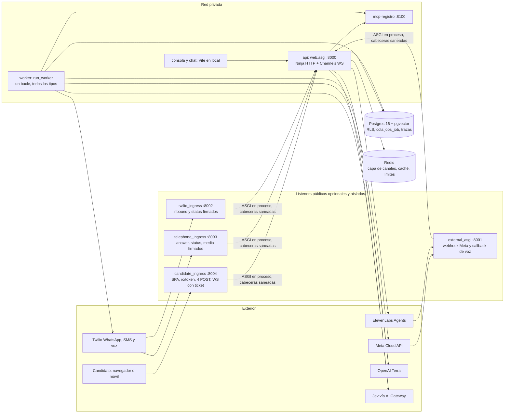

# Despliegue, monitorización y escalado

Capacidad, costes, despliegue, observabilidad y release. El endurecimiento de la
configuración está en [producción](produccion.md).

Cada cifra lleva su naturaleza:

- **Medido:** trazas locales reales o la prueba de carga de este documento.
- **Tarifa:** fuente pública con fecha de consulta (sección final).
- **Supuesto:** parámetro de planificación, editable en `tools/loadtest.py capacity`.
- **Propuesta:** diseño de producción no implementado ni desplegado.

No existe un entorno de producción. Todo lo medido es local, con candidaturas
sintéticas, y no sustituye una prueba con el proveedor real a escala.

## 1. Arquitectura

### Lo que existe



- Los cuatro listeners públicos son aplicaciones ASGI distintas que **delegan en
  proceso** a `web.asgi` tras filtrar ruta, método, host, origen y firma. Ninguno
  expone consola, ingesta de ATS ni API de personal. `candidate_ingress` solo sirve
  candidaturas de prueba mientras su configuración esté activa y cierra los
  WebSockets al caducar la ventana. Se arrancan con los overlays de `docker/*.yml`,
  `make external-ingress` o el listener de [canales con Twilio](twilio.md);
  `make up` no levanta ninguno.
- `api` atiende HTTP (Ninja) y WebSocket (Channels con Redis). El chat web ejecuta
  el turno del modelo **dentro** del consumidor WebSocket. El ORM se invoca con
  `sync_to_async` (hilo único por proceso), y cada turno abre una conexión
  Postgres propia para el bloqueo consultivo de la sesión (`PostgresTurnLock`).
- `worker` es un único bucle síncrono que reclama cualquier tipo de trabajo con
  `SELECT … FOR UPDATE SKIP LOCKED` por `run_at`. Los turnos de WhatsApp
  (`twilio_inbound`, `channel_inbound`) ejecutan el modelo **dentro del trabajo**:
  la medición histórica con Luna fue de ~8 s por turno y proceso; no es una medida
  de rendimiento de Terra.
- Postgres es la única fuente de verdad: perfiles, sesiones, historial, cola,
  outbox, trazas (`tracing_llmcall`, `tracing_capabilitycall`) y eventos. Redis
  guarda solo estado efímero; si cae, las rutas públicas limitadas fallan cerradas.

### Producción propuesta

| Pieza | Despliegue propuesto | Motivo |
|---|---|---|
| Web/chat ASGI | 2 réplicas × 2 procesos uvicorn sin `--reload`, detrás de un balanceador con afinidad solo para WS | Alta disponibilidad; la capacidad no es el límite (§4) |
| Listeners públicos | Un despliegue por listener, 2 réplicas, en su propio host y certificado | Superficie mínima; caída aislada |
| Worker interactivo | `twilio_inbound`, `channel_inbound`, `twilio_send`, `channel_first_contact`, `followup_*`, `telephone_dial`, `sms_link_send`; 12–16 procesos en pico | Cada turno de WhatsApp bloquea un proceso ~8 s (§2.3) |
| Worker de efectos | `outbox_dispatch`, `candidate_snapshot`, `live_sync`, `faq_index`; 2 procesos | Reintentos con idempotencia; no compite con turnos |
| Worker batch | `eval_run`, `maintenance`; 1 proceso, sin autoescalado | Gasto presupuestado; una eval de minutos no bloquea turnos |
| Postgres | Gestionado, multi-AZ, PITR, pgvector, 2 vCPU/8 GB al inicio | Fuente de verdad; CPU medida por turno (§4) |
| Redis | Gestionado con TLS y autenticación (`rediss://`) | Channels, tickets, límites |

Separar workers por tipo **requiere un cambio de código** (p. ej. un filtro de
tipos en `run_worker`); hoy un `eval_run` largo ocupa el mismo bucle que un turno.

### Alojamiento y aislamiento por cliente (decisión de diseño)

Resumen de la [ADR 0002](adr/0002-alojamiento-gestionado-por-orbio.md).

**Propuesta de diseño, no desplegada.** La plataforma se aloja en AWS y la opera Orbio. Nunca
se instala en las instalaciones del cliente: una sola versión del producto, la misma
puerta de evals y la misma observabilidad sirven a todos, y cada mejora llega a
todos los clientes sin migraciones por cliente.

| Modalidad | Para quién | Qué se aísla |
|---|---|---|
| Plataforma compartida, una por región (UE y EE. UU.) | Opción por defecto | Cada cliente es un tenant: RLS por `tenant_id` en Postgres, perfiles, conectores, secretos y trazas propios. Mismos contenedores y base por región |
| Despliegue dedicado | Clientes que lo exijan por contrato, volumen o residencia de datos | Cuenta o base de datos y contenedores propios, en la región que pida el cliente. Mismo artefacto y mismo pipeline de release que la plataforma compartida |

La región se elige por la residencia de los datos de los candidatos, no por la
sede del cliente. El código no distingue entre modalidades: el aislamiento de
tenant es el mismo y un despliegue dedicado es otra instancia de la misma imagen.
Pendiente: dónde se alojan los datos de un cliente con candidatos en varias regiones,
como Grupo Sazón en España y México. Pendiente de concretar con Orbio: cuentas AWS, regiones exactas, proveedores de
modelos admitidos en cada región y acuerdos de tratamiento de datos. Antes de
alojar secretos de clientes reales en la plataforma compartida hay que vincular
cada referencia de secreto a su cliente en un único punto.

## 2. Respuesta: 10.000 candidaturas por semana

**Baseline histórico Luna, no presupuesto del runtime Terra actual.** Las latencias,
cuotas, costes de inferencia y proporciones de esta sección proceden del escenario
Luna de §3. Se conservan para reproducir aquel análisis; hay que volver a medirlos
con Terra antes de usarlos para dimensionar o contratar producción. Las tarifas
por papel del runtime actual están en [inferencia](openai-runtime.md).

Modelo reproducible con `uv run python tools/loadtest.py capacity`. Los supuestos
principales: 10 mensajes del candidato por cribado, pico de 10× la hora media
semanal (concentración diaria más campañas), 8 minutos por conversación de texto,
70 % WhatsApp, 20 % web y 10 % voz, 60 % España y 40 % México, 80 % de cribados
completados.

| Magnitud | Valor | Tipo |
|---|---:|---|
| Candidaturas por hora, media semanal / pico | 59,5 / 595 | Supuesto |
| Turnos del candidato por semana | 100.000 | Supuesto |
| Turnos por minuto en pico | 99 (1,65/s) | Supuesto |
| Conversaciones activas simultáneas en pico | ~80 | Little: 595/h × 8 min |
| Turnos en vuelo en pico (8 s por turno real) | ~13 | Little |
| Peticiones a OpenAI por minuto en pico | ~270 | 1,3 conversador + 1,3 guardián por turno + evaluador |
| Tokens/min reservados en pico | ~0,9 M | Cada llamada reserva el mayor entre `max_completion_tokens` y la entrada estimada |
| Mensajes WhatsApp por segundo en pico (entrada + salida) | 2,3 | Supuesto |
| Minutos de voz por semana | 4.000 | 10 % × 4 min |
| Derivaciones y propuestas a revisar por semana | 1.000 + 3.600 | Supuesto (§2.5) |

### 2.1 Modelo y límites del proveedor — baseline Luna

Límites por defecto de `gpt-6-luna` (tarifa consultada el 28/10/2026): **Build**
5.000 RPM y 2 M TPM, con tope de gasto de 500 USD/mes; **Launch** 10.000 RPM y
10 M TPM, tope 5.000 USD/mes; **Grow** 30.000 RPM y 180 M TPM. El pico estimado usa
el 5 % de las RPM y el 45 % de los TPM de Build, o el 9 % de los TPM de Launch.

**Recomendación del escenario Luna:** Launch como mínimo para producción. Build cabe en la media, pero
un pico 2–3 veces mayor que el supuesto agota sus TPM. El gasto mensual de
inferencia (~210 USD) también ocupa el 42 % del tope de Build. El límite que se
alcanza antes son los **TPM reservados**, no el gasto: `max_completion_tokens` del
conversador (4.096) cuenta en cada petición. Bajarlo a 1.024 casi divide por dos
la reserva sin cambiar el coste. Es un cambio de código pendiente, que se validaría
con evals.

### 2.2 Coste por candidato y por semana — baseline Luna

| Concepto | Por candidato del canal | Semana (10.000) | Base |
|---|---:|---:|---|
| Modelo: conversador, guardián, Jev y evaluador | 0,0048 USD | 48 USD | Medido por turno (§3) × 10 turnos |
| WhatsApp Meta (11,5 mensajes facturables) | 0,26 ES / 0,11 MX; 0,20 USD mezcla | 1.427 USD | Tarifa secundaria, servicio de pago desde el 01/10/2026 |
| Comisión Twilio si es el BSP (0,005 por mensaje de entrada o salida) | 0,11 USD | 753 USD | Tarifa |
| Voz ElevenLabs Agents, 4 min | 0,32 USD | 320 USD | Tarifa 0,08 USD/min |
| Telefonía Twilio, la mitad de las llamadas | 0,21 USD por llamada | 106 USD | ES móvil EEA 0,0486 + Media Streams 0,0044 USD/min |
| Evals: puerta y nocturnas | — | ~1 USD | Medido, 0,025–0,046 USD por ejecución |
| **Total** | **0,19–0,27 USD de media** | **~1.900–2.650 USD** | Sin Meta/Twilio en web |

En este baseline, la inferencia es **~2 % del coste variable**. Domina WhatsApp: según
la página oficial de precios de Meta, desde el 01/10/2026 los mensajes de servicio
dentro de la ventana de 24 h se cobran tras 1.000 gratuitos por número y mes, y
los de utilidad en ventana dejan de ser gratuitos. Cada turno adicional de
WhatsApp en España cuesta ~0,023 USD, unas 55 veces el turno del modelo. Palancas:
un único mensaje por turno, menos turnos, y entrada iniciada por el candidato
(enlace clic-a-WhatsApp, D28), sin plantilla. «Una pregunta cada vez» es una regla
de experiencia con coste: se decide por cliente, no se elimina por precio.

La tarifa por país procede de rate cards de terceros que citan la del 01/10/2026
(España 0,0200–0,0230 y México 0,0085–0,0098 USD por mensaje de utilidad o
servicio). El rate card oficial de Meta no se ha podido leer como texto. La página
de Twilio (septiembre de 2026) aún presenta gratuita la utilidad en ventana. Antes
de presupuestar, **verificar en el rate card de Meta**.

### 2.3 Rendimiento de WhatsApp

- Caudal: 80 mensajes/s por número por defecto (hasta 1.000 con mejora automática).
  El pico de 2,3/s usa el 3 %.
- Límite por pareja: 1 mensaje cada 6 s al mismo usuario. Un mensaje por turno lo
  respeta; dividir una respuesta en varias burbujas o encadenar recordatorios no.
- **Bloqueo de arranque:** el límite de mensajes iniciados por la empresa es por
  cartera y empieza en **250 usuarios únicos/24 h** (después 2.000, 10.000,
  100.000 e ilimitado). 1.429 primeros contactos diarios de media más recordatorios
  requieren el nivel de 10.000. Hay que planificar verificación del negocio y
  rampa de semanas, o empezar por contactos iniciados por el candidato.
- Los turnos de WhatsApp pasan por la cola: el worker interactivo necesita unos
  1,16 turnos/s × 8 s ≈ 9–10 procesos ocupados en pico. Con margen, 12–16.

### 2.4 Voz

4.000 minutos/semana ≈ 17.300/mes. En pico hay unas 60 llamadas/h × 4 min, es
decir, ~4 llamadas simultáneas. Los planes de ElevenLabs admiten de 4 a 40
llamadas concurrentes. Por encima se cobra la tarifa de ráfaga, 0,16 USD/min, así
que conviene un plan con concurrencia ≥ 10. Latencia medida en aceptación local:
primer audio entre 0,68 y 1,16 s (mediana 1,01 s) tras terminar de hablar,
medido en una prueba local de [voz en el navegador](voz.md). La alternativa
`gpt-live-1` se traza a 0,05 USD/min con la estimación del adaptador (10 llamadas,
12 min). La tarifa de Twilio a móviles mexicanos no se ha verificado.

### 2.5 Revisión humana

El dial impone revisión humana a todo rechazo (tope de plataforma en la UE) y a
cualquier `review`, `pool` o `qualify` con banderas. Solo `qualify` limpio con
dial ≥ 2 se aplica solo (`decide_outcome`). Supuestos: el 45 % de los cribados
completados requiere confirmar una propuesta (1 min), y el 10 % de las candidaturas
deriva a una persona (5 min).

| Escenario | Horas de reclutador/semana | Personas a tiempo completo (40 h) |
|---|---:|---:|
| Base: 10 % derivaciones, 1 min por propuesta | 143 | 3,6 (≈3,2 h por local y semana en 45 locales) |
| 5 % derivaciones | 102 | 2,6 |
| 20 % derivaciones, 2 min por propuesta | 287 | 7,2 |

Muestra local, sesgada por pruebas adversariales: 4 de 14 decisiones aplicadas
por el agente y 14 de 64 sesiones derivadas. **La capacidad humana, no el
cómputo, es el primer cuello de botella operativo.** Se mide desde la bandeja
y los eventos de derivación (§7).

## 3. Coste por candidato medido en trazas

Consulta de solo lectura (`SET TRANSACTION READ ONLY` dentro de
`tenant_context`) sobre la base local `screening`, el 28/10/2026. La muestra
contiene **47 sesiones con llamadas reales al modelo, del 22 al 28/10/2026**, todas
con candidaturas de prueba sintéticas (web, WhatsApp y voz), y 23 ejecuciones de
evals terminadas. Coste = `cost_usd_micros` trazado con la tarifa Standard de Luna
y el coste devuelto por el gateway de Jev. Es una estimación, no una factura.

La fórmula de Luna, con tokens de entrada sin caché (I), salida (O), lectura de
caché (R) y escritura (W) contados sin duplicar, es
`USD = (0,10·I + 0,50·O + 0,01·R + 0,125·W) / 10⁶`. Se aplica a todos los roles,
no solo al conversador. Tarifa contrastada el 23/10 y de nuevo el 28/10/2026, en
`adapters/llm/pricing.py`, para contexto de hasta 272K. Por encima se duplica la
entrada y se multiplica la salida por 1,5. Batch/Flex cuestan la mitad.

| Grupo | n | Turnos del candidato (media) | Media USD | p50 | p90 | Máx. |
|---|---:|---:|---:|---:|---:|---:|
| Sesiones sin voz GPT-live | 38 | 5,4 | 0,0025 | 0,0016 | 0,0056 | 0,0074 |
| Solo web | 13 | 3,2 | 0,0019 | 0,0019 | 0,0033 | 0,0046 |
| Completadas con evaluador | 14 | 7,3 | 0,0039 | 0,0024 | 0,0065 | 0,0143 |

Desglose medio por sesión completada: guardián Luna 0,0015, Jev 0,0009, evaluador
0,0009 y conversador 0,0006 USD. **El conversador es la parte más barata** porque
lee casi todo de caché: unos 3 tokens sin caché, 2.500 de lectura de caché, 600 de
escritura y 90 de salida por llamada. El guardián revisa sin caché de lectura.
Planificación: **0,00041 USD por turno + 0,00087 por evaluación ≈ 0,0048 USD por
candidato** de 10 turnos.

Latencias medidas por llamada (p50 / p95): conversador 2,5 / 6,8 s; guardián
Luna 3,1 / 8,6 s; Jev 0,44 / 1,2 s; evaluador 14,9 / 26,1 s. El evaluador corre
**dentro** del turno que llama a `screening.complete`, así que el turno de cierre
tarda ~20–35 s. Tasas en sesiones: Jev escaló a Luna 49 de 99 respuestas, y el
guardián bloqueó 31 de 224 revisiones Luna (14 %; en evals, 45 de 1.075, 4 %).
Ambas cifras proceden de pruebas adversariales y no son una tasa de producción.

Evals: 0,0253 USD de media por ejecución (mediana 0,026; 3–8 casos), ~0,005 USD
por caso. La puerta de publicación de una oferta cuesta unos céntimos. 1.000
juicios muestreados por semana (10 %) añaden ~0,6 USD.

## 4. Prueba de carga con modelo falso

`tools/loadtest.py` arranca **su propio** uvicorn en un puerto libre con
`LLM_MODE=fake`, todas las integraciones externas apagadas y la base aislada
`screening_load` (Redis índice 4). Rehúsa la base `screening` y el índice 0. Cada
candidato virtual recorre el camino público: ingesta firmada con HMAC, apertura de
sesión (IP sintética 198.18.0.0/15 por candidato, como tras un balanceador),
WebSocket con ticket, primer mensaje y N turnos en bucle cerrado sin pausa.

```sh
W=<wrapper de aislamiento que fija DATABASE_URL y REDIS_URL>
$W uv run python tools/loadtest.py prepare        # crea, migra y siembra la base aislada
$W uv run python tools/loadtest.py chat --levels 1,10,20,40 --turns 8 --web-workers 1
$W uv run python tools/loadtest.py queue --jobs 2000 --workers 1,2,4
```

Ejecución del **28/10/2026** en Apple M5 (10 núcleos, 32 GB), macOS 26.5.2,
Python 3.12, Postgres 16 y Redis 7 en Docker. El Postgres es el mismo contenedor
que el stack local en marcha, con otra base. Son 3 sesiones por usuario y 8
turnos por sesión. Turnos/s incluye ingesta y apertura. **El modelo falso excluye
la latencia del proveedor**: mide solo el coste de plataforma. Datos brutos en
`.local/loadtest/` (no versionado).

| Procesos ASGI | Concurrencia | Turnos | Turnos/s | p50 turno | p95 turno | p99 turno | p95 apertura | Errores |
|---:|---:|---:|---:|---:|---:|---:|---:|---:|
| 1 | 1 | 24 | 23,0 | 30 ms | 36 ms | 42 ms | 42 ms | 0 |
| 1 | 10 | 240 | 37,1 | 216 ms | 284 ms | 341 ms | 175 ms | 0 |
| 1 | 20 | 480 | 34,7 | 473 ms | 651 ms | 878 ms | 164 ms | 0 |
| 1 | 40 | 960 | 36,7 | 847 ms | 1.326 ms | 1.452 ms | 430 ms | 0 |
| 4 | 10 | 240 | 49,8 | 127 ms | 346 ms | 370 ms | 67 ms | 0 |
| 4 | 20 | 480 | 57,0 | 227 ms | 527 ms | 629 ms | 94 ms | 0 |
| 4 | 40 | 960 | 54,6 | 476 ms | 1.113 ms | 1.241 ms | 257 ms | 0 |

Cola, con 2.000 trabajos `noop` encolados de golpe:

| Workers | Trabajos/s sostenidos | Edad máxima de cola | p95 encolado → hecho |
|---:|---:|---:|---:|
| 1 | 97,9 | 22,8 s | 21,9 s |
| 2 | 182,2 | 12,3 s | 12,0 s |
| 4 | 338,8 | 7,5 s | 7,3 s |

Interpretación:

- Un proceso se satura en **~35 turnos/s**; por encima, la latencia crece
  linealmente con la concurrencia (ley de Little). El techo procede del hilo único
  del ORM (`sync_to_async`), no de la CPU. Durante la prueba con 4 procesos, cada
  uno usaba entre el 35 y el 58 % de un núcleo, el generador ~5 % y Postgres ~1,2
  núcleos: **~20 ms de CPU de base de datos por turno**. Cuatro procesos rinden
  1,5× porque el siguiente límite es Postgres. Contribuyen las conexiones nuevas
  por petición (`CONN_MAX_AGE=0`) y por turno (bloqueo consultivo).
- El pico de 10.000/semana necesita 1,65 turnos/s: **~5 % de un proceso**. La
  plataforma tiene un margen de un orden de magnitud. Lo que sí escala con los
  turnos reales de 6–8 s son las conexiones en vuelo, los TPM, el coste por
  mensaje y las personas.
- La cola rinde ~98 trabajos/s por worker y escala casi linealmente hasta 4. Con
  turnos reales manda la duración del trabajo, no el reclamo (§2.3).
- Hallazgo: cada consumidor reenvía sus eventos a su propio grupo y
  `channels_redis` registró 1.923 mensajes «over capacity» con 1 proceso (132 con
  4), descartados. Con una pestaña es inocuo, porque el consumidor ignora su eco.
  Antes de confiar en el grupo para varias pestañas u observadores, revisar la
  capacidad del canal o dejar de enviarse eco.
- No probado: guardián, herramientas, evaluador, LangChain real, workers con
  turnos de WhatsApp, varias máquinas, red real, TLS y un Postgres dedicado.

## 5. Escalado operativo

### 5.1 Autoescalado (propuesta)

| Grupo | Señal principal | Regla | Límites |
|---|---|---|---|
| Web/chat | Turnos en vuelo por proceso y p95 del turno sin modelo | +1 réplica si hay > 20 turnos en vuelo por proceso o el p95 de plataforma > 500 ms durante 5 min | 2–8 réplicas; CPU solo como señal secundaria |
| Worker interactivo | Edad del trabajo más antiguo ya vencido de sus tipos | +2 procesos si supera 5 s durante 1 min; −1 si es < 1 s durante 10 min | 4–24; nunca por encima del presupuesto de TPM |
| Worker de efectos | Edad de `outbox_dispatch` | +1 si supera 60 s | 1–4 |
| Batch | — | Fijo | 1 |

Edad de cola, por ejemplo para un escalador KEDA de PostgreSQL:

```sql
SELECT COALESCE(EXTRACT(EPOCH FROM now() - min(run_at)), 0)
FROM jobs_job
WHERE status = 'queued' AND run_at <= now()
  AND kind = ANY('{twilio_inbound,channel_inbound,twilio_send,channel_first_contact}');
```

Se escala por cola y latencia porque un turno real espera al proveedor con la CPU
ociosa. Cada turno en vuelo mantiene **una conexión Postgres** para el bloqueo
consultivo de sesión: ~13 en pico, más el ORM y los workers. Con PgBouncer en modo
transacción ese bloqueo de sesión deja de ser válido. Hay que usar modo sesión o
una DSN directa para el bloqueo, o pasar a un bloqueo transaccional (cambio de código).

### 5.2 Contrapresión

Existente: 30 aperturas/min por IP, 50 mensajes/min por sesión, límite de mensajes
del candidato con derivación automática, ticket WebSocket de 60 s y un solo uso,
límite diario de voz directa y reserva de presupuesto telefónico. Los límites
fallan cerrados si Redis no responde.

Propuesta:

- La palanca controlable de carga es el **primer contacto**. Espaciar
  `channel_first_contact` con `run_at` según un presupuesto de TPM y de mensajes
  iniciados, en lugar de encolar la ingesta de golpe.
- Un cubo de tokens en Redis por proveedor y proyecto, con TPM reservados y RPM.
  Si se agota, el turno de WhatsApp sigue encolado de forma duradera y responde
  más tarde. En web, el indicador de escritura continúa mientras se espera.
- Un semáforo de turnos en vuelo por proceso, para no abrir conexiones de bloqueo
  sin límite.
- Las evals y el mantenimiento se pausan automáticamente si la cola interactiva
  envejece.

### 5.3 Fallos de proveedor

| Fallo | Comportamiento actual | Mejora propuesta |
|---|---|---|
| Modelo caído o error tras 2 reintentos del cliente | Evento `provider_failed`, sesión `handed_off`, mensaje de derivación; se conserva el mensaje entrante | Interruptor: ante un 429 o un corte breve, mantener el turno en cola unos minutos antes de derivar, para no inundar la bandeja |
| Jev con error o *timeout* de 2,5 s | Revisión completa con el guardián Terra/medium | Alertar por coste si el *fallback* supera el 5 % |
| Voz no disponible o límite diario | HTTP 503/429 con «puedes continuar por escrito»; la sesión sigue por texto | — |
| Llamada sin respuesta o cortada | Estado del intento registrado; continúa por WhatsApp o chat | — |
| Entrega ambigua de WhatsApp o SMS | No se reenvía de forma automática; el trabajo queda fallido o muerto para que decida un operador | Panel de entregas fallidas |
| Redis caído | `health` devuelve 503, los límites públicos bloquean y los WS no conectan; Postgres conserva todo | — |

### 5.4 Idempotencia (existente)

`Job.idempotency_key` y `OutboxItem.idempotency_key` son únicos, con conciliación
del outbox cada 60 s. En `Message` son únicos (sesión, `client_message_id`) y
(cliente, canal, `provider_message_id`); en `ChannelInbound` y `ChannelDelivery`,
el ID del proveedor. La ingesta tiene firma HMAC con ventana de 300 s, *nonce* de
un solo uso en Redis y *upsert* por `external_id`. El turno usa bloqueo consultivo
por sesión entre réplicas y un historial *append-only* con detección de conflicto
por secuencia. Los trabajos con efectos externos usan `max_attempts=1`; un trabajo
interrumpido más de 10 min pasa a `dead` para revisión manual, no a otro intento.

## 6. Base de datos: crecimiento, particionado y retención

Tamaño por fila medido en tablas locales, que es una cota alta porque las tablas
pequeñas inflan los índices. Filas por candidato de 10 turnos: supuesto.

| Tabla | Filas por candidato | Bytes por fila | Filas por semana | GB por semana |
|---|---:|---:|---:|---:|
| `conversations_modelmessage` (incluye razonamiento cifrado) | 30 | 1.452 | 300 k | 0,44 |
| `conversations_message` | 22 | 645 | 220 k | 0,14 |
| `tracing_llmcall` | 30 | 251 | 300 k | 0,08 |
| `tracing_capabilitycall` | 15 | 869 | 150 k | 0,13 |
| `conversations_event` | 10 | 580 | 100 k | 0,06 |
| `jobs_job` (vía Twilio, un trabajo por mensaje) | 22 | ~1.000 | 220 k | 0,22 |
| Sesión, candidatura, decisión, outbox | ~5 | ~4.000 | 50 k | 0,2 |
| **Total** | | | | **~1,2–1,3** |

Son unos 60 GB/año sin purga y ~14 M filas/año en las tablas mayores.

- **Desde el primer día:** purgar `jobs_job` en estado `done` o `cancelled` tras
  14 días y crear un índice parcial `WHERE status = 'queued'`. La cola debe seguir
  pequeña aunque las tablas históricas crezcan.
- **Particionado mensual** por `created_at` de trazas, eventos e historial cuando
  una tabla supere ~50–100 M filas, o cuando la retención exija borrar por meses
  (`DROP PARTITION` en lugar de `DELETE`). Al ritmo actual no hace falta el primer
  año. Condiciones: las restricciones únicas deben incluir la clave de partición y
  los *triggers* que impiden reescribir el pasado deben existir en cada partición.
- **Retención:** pendiente de acordar con un responsable. No hay purga automática
  de candidaturas; procedimiento de retirada en
  [privacidad y operación](privacidad-operacion.md). Las métricas agregadas sin
  contenido pueden durar más que transcripciones y trazas con datos personales.
  Antes de tratar datos reales hay que ensayar la restauración y la eliminación,
  también en copias de seguridad.

## 7. Observabilidad

### 7.1 Métricas y su fuente actual

| Métrica | Fuente existente | Hueco |
|---|---|---|
| p95 por turno | `tracing_llmcall.latency_ms` por llamada; marcas de `conversations_message` de entrada → salida | Las marcas de mensajes mezclan respuestas humanas tras derivar. Falta un evento o histograma de turno completo (cambio de código) |
| Bloqueos del guardián | `tracing_capabilitycall`: `platform.reply_guard*` y `platform.tool_guard.jev`, `status='blocked'` | — |
| Escalados de Jev a Terra | `tracing_llmcall` con `model_id` de Jev y `stop_reason='escalated'` | — |
| Coste por candidato | Suma de `cost_usd_micros` por sesión, más mensajes Twilio, duración telefónica y `gpt_live_usage` | Coste de canal sin tarifa en tabla |
| Edad y tamaño de cola | `jobs_job` (`status`, `run_at`, `attempts`, `dead`) | — |
| Fallos de entrega | `TwilioOutbound.state`, `Message.delivery_status`, `ChannelDelivery`, `SmsNotification.state`, outbox `dead` | — |
| Errores de proveedor | Eventos `provider_failed` y `turn_signal_failed`; capacidad Jev con `status='error'` | 429/5xx sin desglosar |
| Carga humana | Eventos `handoff_requested`, `auto_handoff`, `human_claim`, `human_close`; `Decision` propuesta | — |
| HTTP | Log `security.access` con ruta, estado y `elapsed_ms`, sin URL ni cuerpo | Exportar a métricas |

### 7.2 SLO propuestos

| SLO | Objetivo | Base medida |
|---|---|---|
| Turno de texto web, excepto cierre | p95 ≤ 15 s, mensual | Conversador 6,8 + guardián 8,6 s en p95 |
| Turno de cierre con evaluación | p95 ≤ 40 s | Evaluador p95 26 s |
| WhatsApp, de entrada a respuesta enviada | p95 ≤ 20 s | Turno más cola y envío |
| Voz, primer audio tras terminar de hablar | p95 ≤ 1,5 s | Mediana 1,01 s local |
| Webhooks firmados aceptados | 99,95 % | Procesado asíncrono |
| Ingress de candidato disponible | 99,9 % mensual | — |
| Cola interactiva: edad del trabajo vencido | p99 < 10 s | 98 trabajos/s por worker sin modelo |
| Outbox hacia el ATS | p99 < 5 min | — |

### 7.3 Alertas

| Alerta | Condición | Severidad |
|---|---|---|
| Cola interactiva atascada | Edad > 30 s durante 5 min | Aviso urgente |
| Latencia de turno | p95 > 20 s durante 15 min (aviso urgente si > 40 s) | Ticket |
| Proveedor del modelo | `provider_failed` > 2 % de los turnos en 10 min, o cualquier ráfaga de 429 | Aviso urgente |
| Uso de TPM | > 70 % del límite reservado durante 10 min | Ticket |
| Guardián | Tasa de bloqueo > 15 % en 1 h, frente al ~4 % de las evals | Ticket: regresión de prompt o campaña de inyección |
| Jev | Escalado > 60 % o error > 5 % en 1 h | Ticket |
| Coste | p95 por candidato > 3× la línea base diaria, o gasto diario > 80 % del presupuesto | Ticket |
| Entregas | Fallos > 5 % en 30 min, o cualquier outbox `dead` | Aviso urgente |
| Derivaciones | Sin reclamar más de 30 min en horario laboral | Aviso a selección |
| Postgres | Conexiones > 80 %, almacenamiento > 80 % o retraso de réplica > 30 s | Aviso urgente |

### 7.4 Paneles

Los paneles leen de una réplica de lectura con un rol sin escritura y por cliente,
porque RLS exige `app.tenant_id`. La consola ya ofrece analítica, bandeja,
actividad y mantenimiento por cliente. El panel de operación de plataforma sería
Grafana sobre Postgres. Por ejemplo, la latencia por agente y hora:

```sql
SELECT date_trunc('hour', created_at) AS hora, agent,
       percentile_cont(0.95) WITHIN GROUP (ORDER BY latency_ms) AS p95_ms
FROM tracing_llmcall
WHERE created_at > now() - interval '24 hours'
GROUP BY 1, 2;
```

Y el coste por sesión, del que el panel toma la distribución p50/p95:

```sql
SELECT session_id, sum(cost_usd_micros) / 1e6 AS usd
FROM tracing_llmcall
WHERE session_id IS NOT NULL AND created_at > now() - interval '7 days'
GROUP BY 1;
```

Los logs usan IDs internos, nunca tokens de enlace, transcripciones ni teléfonos.

## 8. CI/CD y release

### 8.1 Existente

`.github/workflows/ci.yml` comprueba las migraciones y ejecuta lint, tipos,
contratos de imports y tests con `LLM_MODE=fake` y casetes. También hace typecheck
y build de los frontales, y un e2e en un proyecto Compose aislado. CI nunca llama
al modelo real. No hay pipeline de despliegue.

La **puerta de publicación** (`adapters/persistence/evals_gate.py`) falla cerrada
y exige todo lo siguiente:

- Una ejecución de evals posterior y no superada por otra para la `rev` exacta del
  borrador, por cada oferta abierta.
- Proveedor real (`openai` o `bedrock`): unas evals con el modelo falso nunca
  habilitan una publicación.
- Puntuación mayor o igual que el umbral del borrador y que el de la versión activa.
- Todas las personas con su veredicto esperado, cada «Debe/No debe» superado y sin
  errores.
- La misma identidad de arnés: `runtime_sha256` resume todo `src/**/*.py` y
  `uv.lock`, junto con el hash del perfil y de las personas.

Además se aplican aprobaciones por riesgo (D11) y pilotos por segmento y porcentaje (D40).

### 8.2 Pipeline propuesto

1. **PR:** CI actual y una prueba de carga corta, `loadtest chat --levels 10`,
   contra la línea base de turnos/s del modelo falso. Una regresión mayor del 30 %
   bloquea.
2. **Build:** imagen inmutable por *digest*; se promueve el mismo *digest* a
   staging y producción.
3. **Migraciones:** *expand/contract*, con un rol propietario solo para migrar y
   el rol de ejecución sin propiedad ni BYPASSRLS (ver [producción](produccion.md)).
4. **Staging:** *smoke* de salud y ejecución de evals reales por cliente y oferta
   abierta con `run_evals --max-cost` (~0,03–0,05 USD cada una). Si alguna versión
   activa empeora, no se promueve la imagen.
5. **Producción:** despliegue gradual (*rolling*) de web, listeners y workers. Los
   workers se drenan con SIGTERM: terminan el trabajo actual y los que quedan
   interrumpidos pasan a `dead` o se reencolan según `max_attempts`.
6. **Tras cada despliegue de código** cambia `runtime_sha256`. Las versiones
   activas siguen sirviendo, pero la siguiente publicación de perfil necesita evals
   nuevas en producción con esa imagen. Es intencionado: la puerta acredita la
   pareja código + perfil, no solo el perfil.
7. **Perfil:** borrador → comprobaciones → diff y aprobaciones → evals → piloto
   por segmento o porcentaje → comparación de métricas por versión → 100 % o
   vuelta atrás, que también reconstruye el índice FAQ.

## 9. Alcance del dimensionamiento

- El despliegue, autoescalado y alertas de §1 (producción), §5.1,
  §5.2, §7.2–7.4 y §8.2 constituyen el diseño propuesto para producción.
- Tarifas de WhatsApp por país sin confirmar contra el rate card oficial de Meta;
  tarifa de voz Twilio a México y precios del Jev gateway sin verificar. El coste
  de Jev procede del importe que devuelve el gateway en las trazas.
- Coste medido con pocas sesiones sintéticas y cortas; tasas de derivación,
  bloqueo y escalado sesgadas por pruebas adversariales. Repetir con un piloto.
- Prueba de carga sin modelo real, sin guardián ni herramientas, en una sola
  máquina con Postgres compartido. No mide la latencia del proveedor, los 429 ni
  los turnos de WhatsApp en workers.
- Cambios de código propuestos y no hechos: filtro de tipos en `run_worker`,
  `max_completion_tokens` del conversador, histograma de turno, purga e índice
  parcial de `jobs_job`, y bloqueo compatible con *pooling*.

## Fuentes (consultadas el 28/10/2026)

- OpenAI: [GPT-6 Luna, precios y límites por nivel](https://developers.openai.com/api/docs/models/gpt-6-luna);
  [guía de rate limits: niveles, topes mensuales y cómputo con `max_tokens`](https://developers.openai.com/api/docs/guides/rate-limits).
- Meta: [precios por mensaje y cambios del 01/10/2026](https://developers.facebook.com/documentation/business-messaging/whatsapp/pricing);
  [caudal](https://developers.facebook.com/documentation/business-messaging/whatsapp/throughput);
  [límites de mensajería](https://developers.facebook.com/documentation/business-messaging/whatsapp/messaging-limits);
  [límite por pareja](https://developers.facebook.com/documentation/business-messaging/whatsapp/about-the-platform).
- Rate cards secundarios con la tarifa del 01/10/2026:
  [Gallabox](https://docs.gallabox.com/pricing-and-billing/whatsapp-pricing/rate-card.md),
  [Zernio](https://zernio.com/whatsapp-api-pricing).
- Twilio: [WhatsApp](https://www.twilio.com/en-us/whatsapp/pricing);
  [voz en España](https://www.twilio.com/en-us/voice/pricing/es).
- ElevenLabs: [precios de la API y concurrencia de Agents](https://elevenlabs.io/pricing/api).
