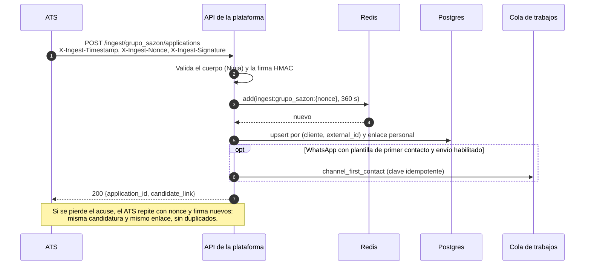
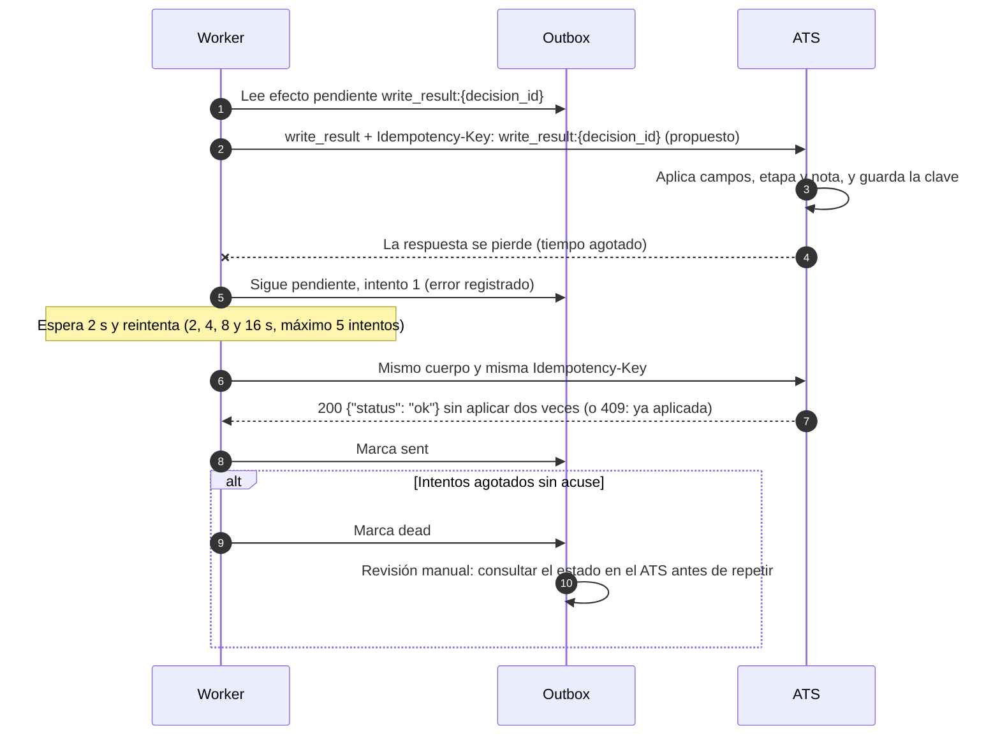
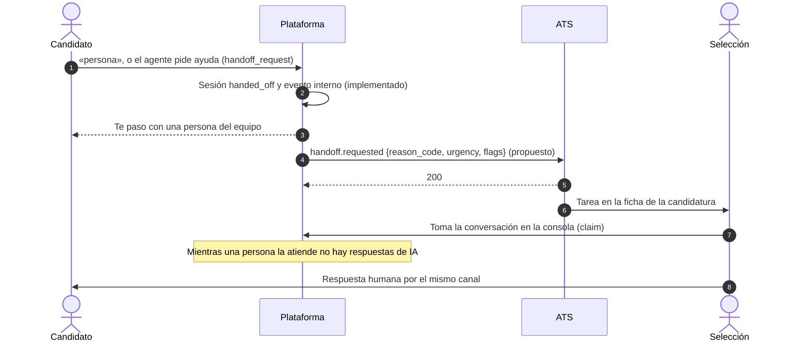
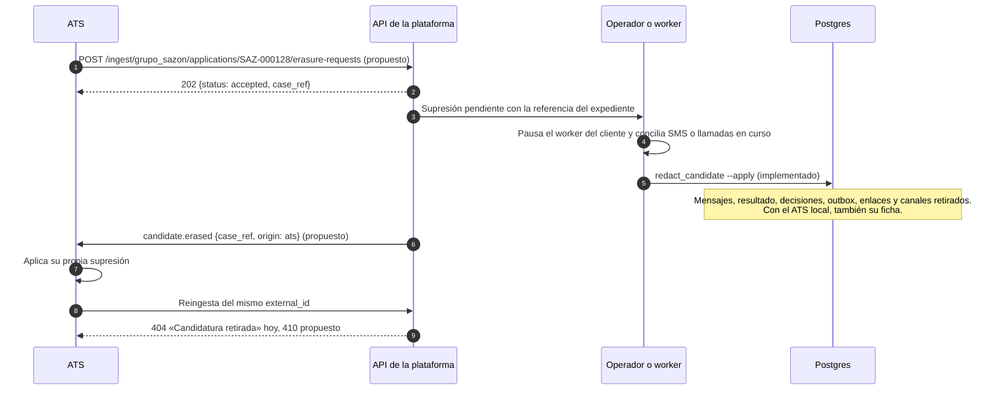

# Integración con un ATS

La especificación completa está en [`ats/openapi.yaml`](ats/openapi.yaml) (OpenAPI 3.1).
Este documento la acompaña: explica los flujos, los riesgos y un ejemplo de mapeo con un
ATS comercial. El contrato HTTP general de la plataforma se publica en `/api/v1/docs` y se
versiona en `packages/api-client/openapi.json`.

La instalación incluye un ATS local (conector nativo `sim_ats`) que implementa este
contrato para desarrollo y pruebas. No hay una integración certificada con Teamtailor
ni con otro proveedor comercial.

## Implementado y propuesto

Cada elemento de la especificación lleva `x-status`: `implemented` si lo hace el código
actual o `proposed` si es diseño para una integración real. La prueba
`tests/contracts/test_ats_spec.py` (dentro de `make check`, sin red ni modelo) mantiene
honesta la parte implementada:

- valida la forma OpenAPI 3.1, las referencias, los `operationId` y cada ejemplo contra su
  esquema (JSON Schema 2020-12);
- compara el cuerpo de la ingesta con el esquema real de Django Ninja y reproduce contra el
  endpoint real cada error documentado como implementado, con el mismo `detail`;
- recalcula el vector de firma con el código de `ingest_auth`;
- reconstruye las escrituras `write_result` y `set_stage` con el código de la aplicación y
  las compara con los ejemplos;
- compara el mapeo de campos con `result_schema` del perfil de Grupo Sazón y los
  vocabularios (veredictos, señales, sentimiento, decisiones, canales) con el dominio.

| Pieza | Estado |
|---|---|
| Ingesta firmada `POST /api/v1/ingest/{tenant_slug}/applications` | Implementada |
| Errores 400, 401, 404, 409 y 503 de la ingesta | Implementados |
| Errores 410, 413, 422 y 429 de la ingesta | Propuestos |
| Formato de error RFC 9457 (`application/problem+json`) | Propuesto; hoy solo `{"detail": "…"}` |
| Petición de supresión desde el ATS | Propuesta |
| Cargas de `ats.write_result` y `ats.set_stage` y su acuse `{"status": "ok"}` | Implementados |
| Outbox, clave idempotente, 5 intentos, reconciliación cada 60 s | Implementados |
| Transporte HTTP firmado hacia el ATS e `Idempotency-Key` en la petición | Propuestos |
| Eventos `screening.completed`, `interview.*`, `handoff.requested`, `candidate.withdrawn`, `candidate.erased` | Propuestos |

## Ingesta

`POST /api/v1/ingest/{tenant_slug}/applications` crea o recupera una candidatura. Campos:
`external_id`, `candidate_name`, `phone`, `city`, `job_ref`, `timezone` (zona IANA, por
defecto `Europe/Madrid`) y `segment`. Responde 200 con `application_id` y `candidate_link`.

- La clave idempotente es `(tenant_slug, external_id)`. Repetir la ingesta con nonce y
  firma nuevos devuelve la misma candidatura y el mismo enlace, y actualiza nombre,
  teléfono, ciudad, zona horaria y segmento. Cambiar `job_ref` devuelve 409.
- El enlace es un secreto personal: no debe entrar en logs ni salir del canal acordado.
- `job_ref` no se valida aquí contra las ofertas publicadas; una oferta inexistente o
  cerrada falla al abrir la conversación. Se propone devolver 422 en la ingesta.
- El `segment` procede de la ingesta confiable. Derivarlo y contrastarlo con datos
  maestros del conector sigue pendiente; no es una autorización aportada por el candidato.
- El origen debe ser el ATS autorizado: la ruta no se publica en el túnel externo y la
  clave no debe estar nunca en un frontend.

### Firma y repetición

`INGEST_TOKEN` es la raíz privada del servidor y nunca se entrega al ATS. La clave de cada
cliente es el hex de HMAC-SHA256(raíz, `ingest-v1:{tenant_slug}`): una clave derivada no
sirve para firmar peticiones de otro cliente. Para provisionarla en un fichero nuevo 0600,
sin imprimirla:

```sh
uv run python manage.py export_ingest_key --tenant grupo_sazon --output .runtime-secrets/ats-grupo-sazon
```

Cabeceras: `X-Ingest-Timestamp` (Unix, 10 cifras), `X-Ingest-Nonce` (16–80 caracteres
alfanuméricos, guion o guion bajo; nuevo en cada petición) y `X-Ingest-Signature` (hex de
HMAC-SHA256 con la clave del cliente). El mensaje firmado son cinco líneas: timestamp,
nonce, `POST`, ruta exacta sin query y SHA-256 hex de los bytes del cuerpo. Ventana: 300 s
hacia atrás y 30 s hacia delante; el nonce se recuerda 360 s. La especificación incluye un
vector de prueba con una raíz ficticia para que el equipo del ATS compruebe su
implementación. Rotar la raíz invalida todas las claves y debe coordinarse con los clientes.

Orden real de las comprobaciones: Ninja valida el cuerpo antes de ejecutar la vista, así que
un cuerpo inválido devuelve 400 aunque falte la firma. Después: firma (401), nonce repetido
(409) o caché caída (503), cliente inexistente o candidatura suprimida (404) y cambio de
oferta o enlace por renovar (409).

Ejemplo ficticio del cuerpo, sin cabeceras:

```json
{
  "external_id": "SAZ-000123",
  "candidate_name": "Lucía Martín Ferrer",
  "phone": "+34600000000",
  "city": "València",
  "job_ref": "repartidores",
  "timezone": "Europe/Madrid",
  "segment": "València"
}
```

### Camino feliz



## Escritura en el ATS (implementada)

Cuando una decisión queda aplicada, la plataforma no llama al ATS dentro de la
conversación: guarda un efecto en el outbox con una clave idempotente y el worker lo entrega
con el conector ATS que tenga permiso de escritura.

| Efecto | Cuándo | Clave idempotente | Carga |
|---|---|---|---|
| `ats.write_result` | Apto aprobado automáticamente (nivel 2 o superior, sin señales) o decisión confirmada/corregida por una persona | `write_result:{decision_id}` | `application_external_id`, `verdict` (`qualified` o `not_qualified`), `fields` por `ats_field` (solo valores no nulos), `summary`, `stage` (`stage_qualified` o `stage_not_qualified`) |
| `ats.set_stage` | El candidato reserva entrevista | `set_stage:{session_id}:interview` | `application_external_id`, `stage` (`stage_interview`), `note` («Entrevista: jueves 29/10/2026 16:00 en Sazón Ruzafa») |

Los veredictos `review` y `pool` nunca llegan al ATS por sí solos: quedan como propuesta y la
persona elige apta o no apta. El conector debe devolver exactamente `{"status": "ok"}`;
cualquier otra respuesta o excepción deja el efecto pendiente.

Entrega actual: hasta 5 intentos con espera `min(2^n, 300)` s (2, 4, 8 y 16 s). Agotados, el
efecto pasa a `dead`. Cada 60 s el worker reencola efectos pendientes sin trabajo y marca para
revisión manual los que quedaron sin confirmación, sin repetir a ciegas. Un trabajo que lleva
más de 10 minutos en curso vuelve a la cola o, si agotó intentos, pasa a revisión manual.

Lagunas conocidas, recogidas como propuesta en la especificación:

- La clave idempotente se guarda en la plataforma pero no viaja al conector: un ATS real no
  puede deduplicar. Se propone enviarla en `Idempotency-Key`.
- No hay orden entre efectos de una misma candidatura. Si `write_result` falla y se reintenta
  después de aplicar `set_stage`, el ATS volvería a «Cribado superado». Se propone una
  `sequence` por candidatura y que el ATS ignore cambios de etapa con secuencia menor.
- Solo el conector nativo `sim_ats` implementa estas operaciones; el adaptador MCP no.
- Hoy todos los errores se reintentan igual. Se propone tratar 400, 401, 403, 404, 410 y 422
  como definitivos y pasar a revisión manual sin reintentos.

### Tiempo agotado ambiguo y reintento idempotente

El outbox, los reintentos y la revisión manual existen hoy; la cabecera `Idempotency-Key` y
la deduplicación en el ATS son la propuesta.



## Eventos propuestos

Los eventos usan un sobre común: `event_id`, `event_type`, `schema_version`, `occurred_at`,
`tenant`, `idempotency_key`, `sequence` (monótona por candidatura), `is_test`, `application`
(`external_id` y `application_id`) y `data`.

| Evento | Qué lleva | Situación actual |
|---|---|---|
| `screening.completed` | Veredicto, motivo, resumen, señales, campos con `value`, `evidence` y `confidence`, sentimiento por etapa, decisión y valores por `ats_field` | El resultado se guarda; solo se escribe en el ATS si la decisión queda aplicada |
| `interview.booked` | Cita con hora absoluta y local, etapa de entrevista | Se refleja con `ats.set_stage` |
| `interview.rescheduled` / `interview.cancelled` | Cita anterior y nueva, o cita cancelada y quién la cancela | Sin implementar |
| `handoff.requested` | Código de motivo, urgencia y señales; nunca el texto libre del agente | La sesión pasa a `handed_off` y se registra un evento interno |
| `candidate.withdrawn` | Baja del canal | La sesión pasa a `abandoned` y se cancelan recordatorios |
| `candidate.erased` | Referencia opaca del expediente y origen | Supresión local con `redact_candidate` |

Entrega: al menos una vez. El ATS deduplica por `X-Screening-Event-Id` o `Idempotency-Key`,
responde 2xx en cuanto guarda el evento y lo procesa después. La firma `X-Screening-Signature`
reutiliza el esquema de la ingesta con una clave de webhooks distinta por cliente. Reintentos
propuestos: 8 intentos con espera exponencial con jitter durante 24 h como máximo; 409 por
clave ya aplicada cuenta como entregado. La `evidence` es una cita literal del candidato: es
dato personal y solo debe llegar al ATS si el contrato lo prevé.

### Derivación a una persona



### Supresión de datos (RGPD)



Si la supresión empieza en la plataforma, el flujo es el mismo desde el paso del operador con
`origin: platform`. Proveedores de mensajería y copias de seguridad requieren gestión aparte.

## Mapeo de los campos de cribado de Grupo Sazón

Perfil de Grupo Sazón (`seeds/tenants/grupo_sazon/profile.json`). El esquema del resultado
separa algunos de los siete campos de cribado del cliente para no perder información ni inferirla.

| Campo de cribado | Validación | Clave del resultado | Campo del ATS | Tipo |
|---|---|---|---|---|
| Nombre completo | Obligatorio | `nombre_completo` | `candidate.name` | texto |
| Carnet de conducir | Sí/No; un No descarta | `carnet` | `custom.licencia` | booleano |
| | Tipo declarado, sin extrapolar entre países | `tipo_carnet` | `custom.tipo_licencia` | texto |
| Ciudad / zona | Dentro de las áreas de servicio | `ciudad` | `custom.ciudad` | texto |
| | Barrio o zona declarada | `zona` | `custom.zona` | texto |
| | Local con vacantes aceptado | `local_asignado` | `custom.local` | texto |
| Disponibilidad | Completa, media jornada o fines de semana | `disponibilidad` | `custom.disponibilidad` | enumerado |
| Horario preferido | Mañana, tarde, noche o flexible | `turno` | `custom.turno` | enumerado |
| Experiencia previa en reparto | Años; opcional, nunca inferida | `experiencia_anios` | `custom.experiencia_anios` | número ≥ 0 |
| | Plataformas; opcional, nunca inferidas | `experiencia_plataforma` | `custom.experiencia_plataforma` | texto |
| Fecha de incorporación | Fecha ISO futura en la zona del candidato | `incorporacion` | `custom.fecha_inicio` | fecha |

Un valor nulo no se envía al ATS. La publicación de un perfil exige que todos los campos
tengan `ats_field` (comprobación E001); conviene además que no se repitan, porque el último
sobrescribiría al anterior.

## Ejemplo: Teamtailor

Ejemplo de cómo se traduciría `ats.write_result` y `ats.set_stage` a Teamtailor. Los datos
de su API proceden de su documentación pública (`docs.teamtailor.com`, colección de
Postman), consultada el 28/10/2026; hay que confirmarlos en una cuenta de pruebas antes de
construir el adaptador.

Lo que dice esa documentación:

- Sigue la especificación JSON:API. La URL base es `api.teamtailor.com` (UE) o
  `api.na.teamtailor.com` (Norteamérica).
- Autenticación con `Authorization: Token token=…`. La cabecera `X-Api-Version` es
  obligatoria y usa versiones fechadas (los ejemplos usan `20240904`). Los ejemplos de
  escritura envían `Content-Type: application/vnd.api+json`.
- Límite de 50 peticiones cada 10 segundos; al superarlo responde 429 e informa con
  `X-Rate-Limit-Limit`, `X-Rate-Limit-Remaining` y `X-Rate-Limit-Reset`.
- Candidatos y candidaturas (`job-applications`) requieren una clave de alcance Admin; con
  lectura/escritura se pueden actualizar.
- Una `job-application` tiene relación con `candidate`, `job`, `stage` (etapa actual) y
  `reject-reason`, y el atributo `rejected-at`. `PATCH /v1/job-applications/{id}` se describe
  como cambio de atributos y relaciones. Las etapas son propias de cada oferta (`stages`),
  con tipos `inbox`, `screening`, `interview`, `offer` y `hired`.
- Los valores de campos personalizados (`custom-field-values`) tienen un propietario
  polimórfico: candidato u oferta, no candidatura. Tipos: texto, email, URL, teléfono, fecha
  ISO 8601, casilla, número, selección (identificador de opción) y selección múltiple. Cada
  campo personalizado tiene un `api-name`.
- Las notas (`POST /v1/notes`) se asocian al candidato y, opcionalmente, a una candidatura;
  el ejemplo incluye también el usuario autor.
- El recurso `interviews` es de solo lectura y corresponde a la valoración de entrevistas;
  la colección no ofrece un recurso para crear citas.
- La colección no incluye borrado de candidatos ni una cabecera de idempotencia.

Mapeo propuesto para el adaptador:

| Plataforma | Teamtailor |
|---|---|
| `application_external_id` | Identificador de la `job-application` (guardar también el del candidato al ingerir) |
| `fields["custom.*"]` | `custom-field-values` con propietario candidato y `custom-field` resuelto por `api-name`; booleano → casilla, número → número, fecha → fecha, enumerado → identificador de la opción |
| `fields["candidate.name"]` | No sobrescribir `first-name`/`last-name`: partir un nombre completo pierde información. Guardarlo como campo personalizado o nota |
| `stage` | Relación `stage` de la candidatura, con el identificador de la etapa de esa oferta resuelto por nombre o tipo |
| `summary` y `note` | Nota asociada al candidato y a la candidatura, con un usuario técnico como autor |
| `candidate.erased` | Tarea para un administrador de Teamtailor; no hay borrado de candidatos por API |

Ejemplo de la fecha de incorporación como valor de campo personalizado (identificadores
ficticios):

```http
POST /v1/custom-field-values HTTP/1.1
Host: api.teamtailor.com
Authorization: Token token=<clave del cliente>
X-Api-Version: 20240904
Content-Type: application/vnd.api+json

{
  "data": {
    "type": "custom-field-values",
    "attributes": { "value": "2026-11-02" },
    "relationships": {
      "custom-field": { "data": { "id": 812, "type": "custom-fields" } },
      "owner": { "data": { "id": 4471, "type": "candidates" } }
    }
  }
}
```

Consecuencias de diseño:

- Una escritura de la plataforma son varias llamadas a Teamtailor (un valor por campo,
  etapa y nota). Con 11 campos y el límite de 50 peticiones cada 10 s, el adaptador debe
  serializar por cliente, respetar el 429 y agrupar lo que pueda.
- Sin idempotencia en la API, el adaptador tiene que conciliar antes de repetir: leer los
  valores y notas de la candidatura y aplicar solo lo que falte, guardando la clave
  idempotente en el texto de la nota o en un campo técnico.
- Las etapas cambian por oferta: el mapeo `stage_qualified`, `stage_not_qualified` y
  `stage_interview` debe resolverse a identificadores por oferta durante la puesta en marcha.
- La vía de Teamtailor hacia la ingesta (disparadores o integración de partners) no se ha
  verificado y queda fuera de este ejemplo.

## Condiciones antes de conectar un ATS real

Credenciales limitadas por cliente; contrato y finalidades de datos; mapeo validado con el
propietario del ATS; envío de la clave idempotente y deduplicación en destino; tratamiento
del orden de etapas; estados de error observables; supresión y retención acordadas;
conciliación de tiempos agotados; y prueba de carga con los límites del proveedor.
